# Lab03 – ALU + Banco de Registros + Diseño Modular

## Integrantes

- Julian David Gomez Gonzalez - 1007544331
- Cristian Norbey Hernández Gualteros - 1001091723
- Milton Nicolas Rincón Caicedo - 1021312724

**Semestre:** 2026-2
**Plataforma:** Digilent Zybo Z7-10 (Zynq-7000)

---

## Índice

1. [Descripción del sistema](#1-descripción-del-sistema)
2. [Arquitectura modular](#2-arquitectura-modular)
3. [Interfaz de usuario](#3-interfaz-de-usuario)
4. [Estrategia de visualización](#4-estrategia-de-visualización)
5. [Simulación](#5-simulación)
6. [Implementación en FPGA](#6-implementación-en-fpga)
7. [Evidencia de funcionamiento en FPGA](#7-evidencia-de-funcionamiento-en-fpga)
8. [Análisis de resultados](#8-análisis-de-resultados)
9. [Conclusiones](#9-conclusiones)

---

## 1. Descripción del sistema

Se implementó un sistema digital de 4 bits sobre la Zybo Z7, dividido en módulos independientes que se integran en `top.v`. El sistema está formado por:

- Un **banco de 4 registros** de 4 bits (`R0`–`R3`).
- Una **ALU de 4 bits** con 2 operaciones aritméticas y 6 lógicas.
- Un **selector de combinaciones** que genera las parejas de operandos `(A, B)`.
- Un **driver para el display TM1637** de 4 dígitos de 7 segmentos.

El flujo de uso es:

1. Se cargan valores en los registros con los switches.
2. Se elige la pareja de registros que actúa como operandos.
3. Se elige la operación con los switches y se ejecuta con `BTN3`.
4. El resultado aparece en el display.

El display solo se actualiza al presionar `BTN3`. Al ejecutar, se guardan el resultado de la ALU y el código de la operación en un registro; mientras no se vuelva a ejecutar, el display conserva ese valor aunque cambien los switches, los registros o la pareja de operandos.

---

## 2. Arquitectura modular

### 2.1 Diagrama de bloques

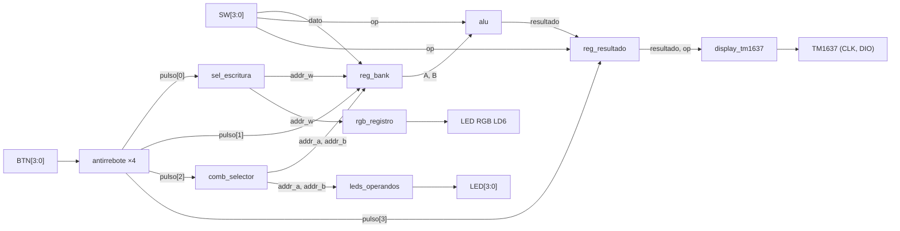

### 2.2 Módulos

Los cinco módulos que pide la guía son la base del diseño. Se agregaron módulos pequeños para tareas que no corresponden a ninguno de ellos y que no deben quedar en `top.v`, ya que este solo instancia y conecta.

| Módulo | Archivo | Tipo | Función |
| --- | --- | --- | --- |
| `alu` | `alu.v` | Combinacional | Ejecuta la operación indicada por `op` sobre `A` y `B`. |
| `reg_bank` | `reg_bank.v` | Secuencial | 4 registros de 4 bits. Escritura síncrona con `write_enable`; lectura combinacional por dos puertos (`addr_a`, `addr_b`). |
| `sel_escritura` | `reg_bank.v` | Secuencial | Contador de 2 bits que elige el registro de escritura. Avanza con `BTN0` (`R0 → R1 → R2 → R3 → R0`). |
| `comb_selector` | `comb_selector.v` | Secuencial | Contador módulo 6 cuyo índice se traduce a una pareja `(A, B)`. Avanza con `BTN2`. |
| `display_tm1637` | `display_tm1637.v` | Secuencial | Une `formato_display` y `tm1637_driver`. |
| `formato_display` | `display_tm1637.v` | Combinacional | Convierte el resultado guardado en los 4 dígitos (decimal o binario) y luego en segmentos. |
| `tm1637_driver` | `display_tm1637.v` | Secuencial | Máquina de estados que envía los dígitos al TM1637 por el bus `CLK`/`DIO`. |
| `antirrebote` | `almacenamiento.v` | Secuencial | Sincroniza el botón y entrega **un pulso de un ciclo** por pulsación, filtrando rebotes menores a 10 ms. |
| `reg_resultado` | `almacenamiento.v` | Secuencial | Guarda el resultado de la ALU y el código de operación solo cuando llega el pulso de `BTN3`. |
| `leds_operandos` | `indicadores.v` | Combinacional | Enciende los LEDs de los dos registros activos. |
| `rgb_registro` | `indicadores.v` | Combinacional | Asigna un color del LED RGB a cada registro de escritura. |
| `top` | `top.v` | Estructural | Instancia los módulos y los conecta con los pines de la placa. |
| `tm1637_monitor` | `tm1637_monitor.v` | Solo simulación | Lee el bus del TM1637 y reconstruye el texto del display. No se sintetiza. |

**¿Por qué el antirrebote?** Un botón físico rebota durante unos milisegundos al presionarlo y al soltarlo. Sin filtro, una sola pulsación generaría varios flancos: `BTN0` saltaría registros, `BTN2` se saltaría combinaciones y `BTN1` escribiría varias veces. El antirrebote solo acepta un cambio si se mantiene durante 1 250 000 ciclos (10 ms a 125 MHz) y entrega un pulso de un ciclo únicamente al presionar.

### 2.3 Operaciones de la ALU

| `SW[2:0]` | Operación | Expresión | Tipo |
| :---: | --- | --- | --- |
| `000` | Suma | `A + B` | Aritmética |
| `001` | Resta | `A - B` | Aritmética |
| `010` | AND | `A & B` | Lógica |
| `011` | OR | `A \| B` | Lógica |
| `100` | XOR | `A ^ B` | Lógica |
| `101` | XNOR | `~(A ^ B)` | Lógica |
| `110` | NOT | `~A` | Lógica (solo usa `A`) |
| `111` | NAND | `~(A & B)` | Lógica |

La ALU es combinacional: su salida cambia en cuanto cambian los operandos o la operación. Por eso el resultado no se envía directo al display, sino que pasa por `reg_resultado`.

El resultado es de 4 bits, así que la suma y la resta trabajan en **módulo 16**:

- **Desborde de la suma:** si el resultado supera 15, se pierde el acarreo. Ejemplo: `12 + 9 = 21`, que se muestra como `5` (21 − 16).
- **Resta con resultado negativo:** si `B > A`, el resultado da la vuelta. Ejemplo: `4 − 6 = −2`, que se muestra como `14` (16 − 2). El sistema no representa números negativos.

### 2.4 Combinaciones de operandos

Cada pulso de `BTN2` avanza el índice del selector. Después de la combinación 5 vuelve a la 0. `A` siempre es el registro de menor número, lo que define el orden de la resta.

| Índice | A | B | `LED[3:0]` |
| :---: | :---: | :---: | :---: |
| 0 | R0 | R1 | `0011` |
| 1 | R0 | R2 | `0101` |
| 2 | R0 | R3 | `1001` |
| 3 | R1 | R2 | `0110` |
| 4 | R1 | R3 | `1010` |
| 5 | R2 | R3 | `1100` |

---

## 3. Interfaz de usuario

### 3.1 Controles e indicadores

| Elemento | Función |
| --- | --- |
| `SW[3:0]` | Dato a escribir en el registro seleccionado. |
| `SW[2:0]` | Código de la operación de la ALU. |
| `BTN0` | Selecciona el registro de escritura (`R0 → R1 → R2 → R3 → R0`). |
| `BTN1` | Escribe el valor de `SW[3:0]` en el registro seleccionado. |
| `BTN2` | Cambia la pareja de operandos `(A, B)`. |
| `BTN3` | Ejecuta la operación y actualiza el display. |
| `LED[3:0]` | Registros que forman la pareja activa. |
| LED RGB (LD6) | Registro seleccionado para escritura. |
| Display TM1637 | Resultado de la última operación ejecutada. |

| Registro de escritura | Color del LED RGB |
| :---: | :---: |
| R0 | Rojo |
| R1 | Verde |
| R2 | Azul |
| R3 | Amarillo |

### 3.2 Uso compartido de los switches

La placa tiene 4 switches, y la guía los usa para el dato (`SW[3:0]`) y para la operación (`SW[2:0]`). Ambos usos no se cruzan porque cada uno se "congela" con un botón distinto:

1. **Carga:** con el dato en `SW[3:0]`, `BTN1` lo guarda en el banco. Después los switches se pueden mover sin perder el valor.
2. **Ejecución:** con la operación en `SW[2:0]`, `BTN3` guarda el resultado y el código de operación. `SW3` se ignora en este paso.

Por eso, después de cargar los datos siempre hay que poner los switches en el código de la operación antes de presionar `BTN3`.

### 4.3 Secuencia de uso

1. Con `BTN0`, elegir el registro (el LED RGB indica cuál).
2. Poner el valor en `SW[3:0]` y presionar `BTN1`. Repetir para cada registro.
3. Con `BTN2`, elegir la pareja de operandos (los LEDs indican cuál).
4. Poner la operación en `SW[2:0]` y presionar `BTN3`.

---

## 4. Estrategia de visualización

### 4.1 Formato según la operación

Se usan **dos sistemas de representación**, según el tipo de operación. Para decidirlo, el display usa el código de operación guardado al presionar `BTN3`, no el de los switches, así el formato tampoco cambia hasta una nueva ejecución.

**Aritméticas (suma y resta) → decimal.** El resultado es una cantidad, así que se lee mejor en decimal. Se usan los dos dígitos de la derecha y los de la izquierda quedan apagados.

**Lógicas (AND, OR, XOR, XNOR, NOT, NAND) → binario.** Las operaciones lógicas actúan bit a bit. Como el resultado tiene 4 bits y el display 4 dígitos, cada dígito muestra un bit y la operación se puede comprobar directamente.

En las tablas, `·` representa un dígito apagado.

| Operación | A | B | Resultado | Display |
| --- | :---: | :---: | :---: | :---: |
| Suma | 7 | 5 | 12 | `··12` |
| Suma (desborde) | 12 | 9 | 21 → 5 | `···5` |
| Resta | 9 | 4 | 5 | `···5` |
| Resta (negativa) | 4 | 6 | −2 → 14 | `··14` |
| AND | `1100` | `1010` | `1000` | `1000` |
| OR | `1100` | `1010` | `1110` | `1110` |
| XOR | `1100` | `1010` | `0110` | `0110` |
| XNOR | `1100` | `1010` | `1001` | `1001` |
| NOT | `1100` | — | `0011` | `0011` |
| NAND | `1100` | `1010` | `0111` | `0111` |

Con `A = 1100` y `B = 1010` aparecen las cuatro combinaciones de bits (1-1, 1-0, 0-1, 0-0), por lo que cada resultado corresponde a la tabla de verdad completa de la operación.

### 4.2 Comunicación con el TM1637

El TM1637 se controla con dos líneas:

- **`CLK`**: la maneja solo la FPGA e indica cuándo leer.
- **`DIO`**: lleva los datos. Es de drenador abierto: la FPGA solo la pone en 0 o la suelta, y la resistencia de pull-up la lleva a 1. Así, el TM1637 también puede bajarla para responder.

`DIO` solo cambia mientras `CLK` está en 0, y el TM1637 lee un bit en cada flanco de subida de `CLK`, empezando por el bit menos significativo. Los únicos cambios de `DIO` con `CLK` en 1 son las condiciones de control:

- **START:** `DIO` baja con `CLK` en 1.
- **STOP:** `DIO` sube con `CLK` en 1.

Después de cada byte hay un noveno pulso de `CLK` (**ACK**), en el que el TM1637 baja `DIO` para confirmar la recepción.

El driver envía continuamente una trama de tres etapas:

| Etapa | Bytes | Significado |
| :---: | --- | --- |
| 1 | `0x40` | Modo escritura con dirección automática. |
| 2 | `0xC0` + 4 dígitos | Empieza en el dígito 0 y envía los segmentos de los 4 dígitos. |
| 3 | `0x8A` | Enciende el display con brillo 2 de 7. |

Los dígitos no viajan como números, sino como el patrón de segmentos que se enciende. Por ejemplo, el `1` se envía como `0x06` (segmentos b y c).

Al inicio de cada trama, el driver copia los dígitos en un buffer, por lo que una trama nunca mezcla dígitos de dos resultados. Con `TM_DIV = 625`, cada fase del bus dura 5 µs y la frecuencia de `CLK` es de 50 kHz.

---

## 5. Simulación

### 5.1 Testbench por módulo

| Testbench | Módulo | Qué se verifica |
| --- | --- | --- |
| `tb_alu.v` | `alu` | Las 8 operaciones, el desborde de la suma, la resta con resultado negativo y que NOT ignore `B`. |
| `tb_reg_bank.v` | `reg_bank`, `sel_escritura` | Escritura de R0–R3, que sin `write_enable` no se escriba, la vuelta de `addr_w` a 0 y la lectura de las 6 parejas por los dos puertos. |
| `tb_comb_selector.v` | `comb_selector` | Las 6 parejas en orden, la vuelta a R0-R1 y que sin pulso no cambie. |
| `tb_almacenamiento.v` | `antirrebote`, `reg_resultado` | Que el ruido corto no genere pulsos, que una pulsación con rebotes genere exactamente uno y que el registro solo cambie con `ejecutar`. |
| `tb_indicadores.v` | `leds_operandos`, `rgb_registro` | LEDs de las 6 parejas y color de cada registro. |
| `tb_tm1637_trama.v` | `display_tm1637` | Trama completa del bus. Incluye un modelo del TM1637 que detecta START y STOP, lee los bits, responde el ACK y reconstruye el texto del display. |

### 5.2 Testbench del sistema completo

`tb_top.v` instancia `top.v` y sigue la misma secuencia que se haría en la placa. El texto del display se obtiene de los segmentos que genera `formato_display`. Los botones se simulan sin rebotes, ya que el antirrebote se prueba por separado en `tb_almacenamiento.v`.

| Paso | Qué hace | Resultado esperado |
| --- | --- | --- |
| 1. Escritura | Carga 5, 3, 12 y 9 en R0–R3 con `BTN1` y `BTN0`. | Banco = `[5 3 12 9]`. |
| 2. Pareja R0, R1 | Ejecuta suma y AND con `BTN3`. | `8` → `   8` y `0001` → `0001`. |
| 3. Pareja R0, R2 | Avanza con `BTN2` y ejecuta XOR. | `1001` → `1001`. |
| 4. Conservación | Cambia los switches y pasa a la pareja R0, R3 **sin** presionar `BTN3`. | El resultado y el display siguen en `1001`. |
| 5. Pareja R0, R3 | Ejecuta suma y resta. | `14` → `  14` y `12` → `  12` (5 − 9 = −4, en módulo 16). |

### 5.3 Formas de onda

#### ALU (`tb_alu.v`)

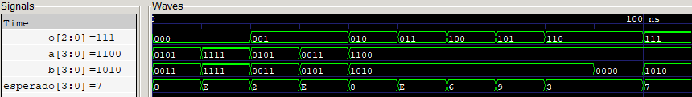

Señales: `op`, `A`, `B` y `esperado`, en binario. Cada prueba dura 10 ns y se aplican las 8 operaciones.

- **0–40 ns, suma y resta:** `0101 + 0011 = 1000` (8) y `0101 - 0011 = 0010` (2). Además se prueban los límites de 4 bits: `1111 + 1111` da `1110` (14), porque se pierde el acarreo de 30, y `0011 - 0101` da `1110` (14 o  E), que es −2 en módulo 16.
- **40–110 ns, operaciones lógicas:** con `A = 1100` y `B = 1010` aparecen las cuatro combinaciones de bits, así que cada resultado corresponde a la tabla de verdad completa: AND `1000`, OR `1110`, XOR `0110`, XNOR `1001` y NAND `0111`.
- **80–100 ns, NOT:** se ejecuta dos veces con el mismo `A` y distinto `B` (`1010` y `0000`), y en ambos casos el resultado es `0011`. Esto confirma que el negador solo usa `A`.

En todos los tramos `esperado` cambia en el mismo instante que las entradas, porque la ALU es combinacional.

#### Banco de registros (`tb_reg_bank.v`)

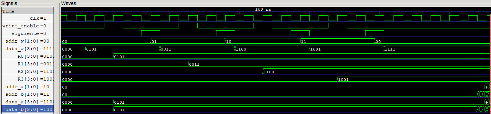

Señales: `clk`, `write_enable`, `siguiente`, `addr_w`, `data_w`, `R0`–`R3`, `addr_a`, `addr_b`, `data_a` y `data_b`, en decimal.

- **Escritura (20–150 ns):** se repite cuatro veces la secuencia pulso de `write_enable` → pulso de `siguiente`. En el flanco de subida de `clk` en que `write_enable` está en 1, solo cambia el registro que indica `addr_w`: R0 toma 5, R1 toma 3, R2 toma 12 y R3 toma 9. Con cada pulso de `siguiente`, `addr_w` avanza, y después de R3 vuelve a 0.
- **Sin escritura (150–190 ns):** `data_w` pasa a 15, pero como `write_enable` sigue en 0, ningún registro cambia.
- **Lectura (190–250 ns):** `addr_a` y `addr_b` recorren las 6 parejas. `data_a` y `data_b` muestran de inmediato el valor del registro correspondiente, porque la lectura es combinacional; por ejemplo, con `addr_a = 0` y `addr_b = 2` se leen 5 y 12.

#### Selector de combinaciones (`tb_comb_selector.v`)

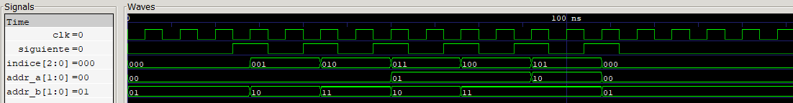

Señales: `clk`, `siguiente`, `indice`, `addr_a` y `addr_b`, en decimal.

Cada pulso de `siguiente` hace avanzar `indice` en el siguiente flanco de subida de `clk`, y en ese mismo instante `addr_a` y `addr_b` cambian a la nueva pareja: (0, 1), (0, 2), (0, 3), (1, 2), (1, 3) y (2, 3). Con el sexto pulso, `indice` pasa de 5 a 0 y la pareja vuelve a (0, 1). En el tramo final no hay pulsos y el índice se mantiene.

#### Antirrebote (`tb_almacenamiento.v`)

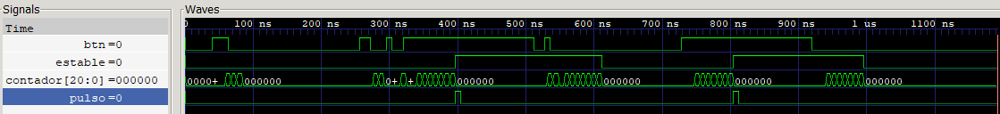

Señales: `btn`, `ar.estable`, `ar.contador` (decimal) y `pulso`. Se muestra el tramo de 0 a 1110 ns.

- **Ruido corto (~40 ns):** `btn` sube solo 3 ciclos. `contador` empieza a contar, pero se reinicia en cuanto `btn` vuelve a 0, y `pulso` no se activa.
- **Pulsación con rebotes (~250–730 ns):** `btn` sube y baja varias veces antes de quedarse en 1. Cada rebote reinicia `contador`; solo cuando `btn` se mantiene estable durante 8 ciclos, `estable` pasa a 1 y `pulso` genera **un único pulso** de un ciclo. Al soltar también hay rebotes, y cuando `estable` vuelve a 0 no se genera ningún pulso.
- **Segunda pulsación (~720–1110 ns):** una pulsación limpia genera un segundo pulso, lo que confirma que el filtro queda listo después de soltar.

#### Registro del resultado (`tb_almacenamiento.v`)

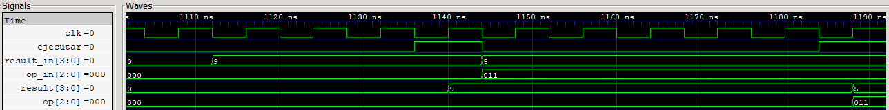

Señales: `clk`, `ejecutar`, `result_in`, `op_in`, `result` y `op`, en decimal y binario. Se muestra el tramo final de la simulación, desde ~1100 ns.

`result_in` pasa a 9 y, mientras `ejecutar` está en 0, `result` sigue en 0. Con el primer pulso de `ejecutar`, `result` toma 9 y `op` toma `000`. Luego `result_in` cambia a 5 y `op_in` a `011`, pero `result` y `op` **se mantienen** en 9 y `000` hasta el segundo pulso de `ejecutar`, cuando pasan a 5 y `011`. Este es el mecanismo que conserva el resultado del display hasta presionar `BTN3`.

#### LEDs y LED RGB (`tb_indicadores.v`)

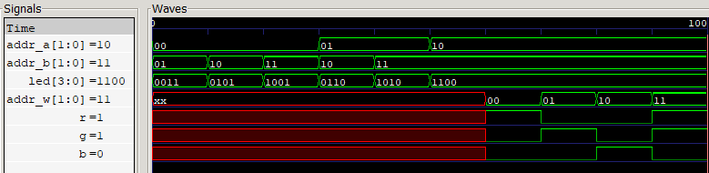

Señales: `addr_a`, `addr_b`, `led` (binario), `addr_w`, `r`, `g` y `b`. Cada prueba dura 10 ns.

- **0–60 ns, LEDs de operandos:** para cada pareja, `led` tiene en 1 exactamente los bits de los dos registros activos: `0011`, `0101`, `1001`, `0110`, `1010` y `1100`.
- **60–100 ns, LED RGB:** `addr_w` recorre 0 a 3 y `{r, g, b}` toma `100` (rojo), `010` (verde), `001` (azul) y `110` (amarillo). Antes de los 60 ns `addr_w` aún no tiene valor asignado, por eso aparece indefinido.

#### Trama del TM1637 (`tb_tm1637_trama.v`)

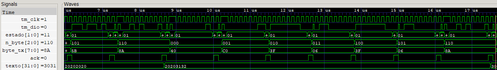

Señales: `tm_clk`, `tm_dio`, `estado`, `n_byte` (decimal), `byte_tx` (hexadecimal), `ack` y `texto` (ASCII). Vista completa, con las dos tramas enviadas.

Cada trama se ve como tres grupos de pulsos de `tm_clk`: uno corto para `0x40`, uno largo para `0xC0` y los 4 dígitos, y otro corto para `0x8A`. Entre los grupos, `tm_clk` queda en 1 y `tm_dio` marca el STOP y el siguiente START. `byte_tx` muestra el byte que se está enviando y `n_byte` su posición en la trama (0 a 6). Al recibir `0x8A`, `texto` se actualiza: después de la primera trama muestra `"  12"` (suma = 12) y después de la segunda `"0101"` (AND = `0101`).

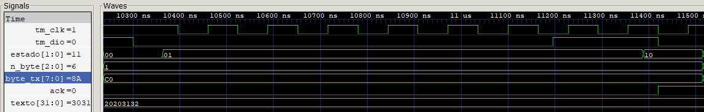

Detalle de la etapa 2 de la primera trama. `tm_dio` solo cambia mientras `tm_clk` está en 0, y el receptor lee un bit en cada flanco de subida de `tm_clk`, empezando por el menos significativo. Después de cada 8 bits hay un noveno pulso en el que `ack` está en 1: el modelo del TM1637 baja `tm_dio` para confirmar la recepción. Los bytes enviados son `C0`, `00`, `00`, `06` y `5B`: la dirección del primer dígito, dos dígitos apagados y los segmentos de `1` y `2`.

#### Sistema completo: escritura (`tb_top.v`)

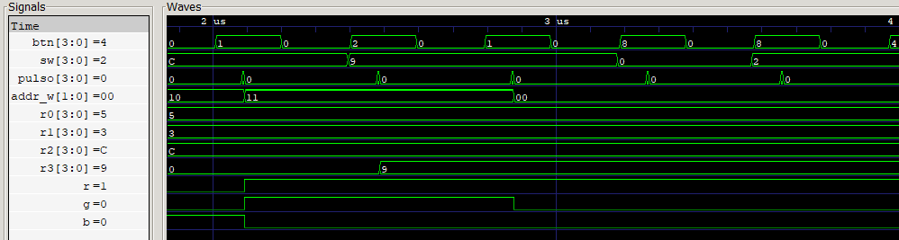

Señales: `btn` y `sw` (binario), `dut.pulso` (binario), `dut.addr_w`, `R0`–`R3` (decimal), `dut.led6_r`, `dut.led6_g` y `dut.led6_b`. Tramo de 0 a ~3.2 µs.

Para cada registro, `sw` toma el valor a escribir y se presiona `BTN1` y luego `BTN0`. Cada pulsación genera un único pulso en `dut.pulso`. Con el pulso de `BTN1` cambia solo el registro indicado por `addr_w`, y con el de `BTN0`, `addr_w` avanza y el LED RGB cambia de color. Al final el banco queda en `[5 3 12 9]`.

#### Sistema completo: ejecución y conservación (`tb_top.v`)

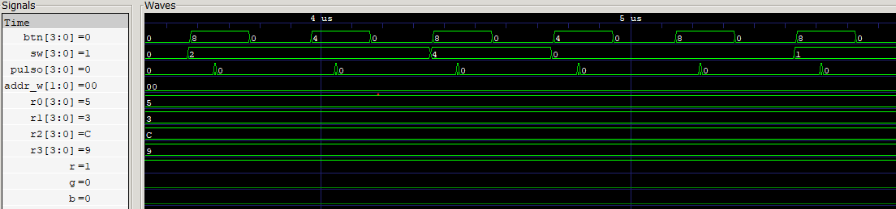

Señales: `btn` y `sw` (binario), `dut.addr_a`, `dut.addr_b`, `led` (binario), `alu_result`, `resultado` (decimal) y `texto` (ASCII). Tramo desde ~3.2 µs hasta el final.

- **R0, R1:** con `sw = 0000` (suma), `BTN3` guarda 8 y `texto` muestra `"   8"`. Con `sw = 0010` (AND), guarda 1 y muestra `"0001"`.
- **R0, R2:** `BTN2` cambia la pareja y `led` pasa de `0011` a `0101`. Con `sw = 0100` (XOR) se guarda 9 y el display muestra `"1001"`.
- **Conservación:** `sw` pasa a `0000` y `BTN2` cambia la pareja a R0, R3. `alu_result` cambia con cada movimiento, pero `resultado` y `texto` **se mantienen** en 9 y `"1001"`, porque no se presionó `BTN3`.
- **R0, R3:** al presionar `BTN3` se ejecuta la suma (14, `"  14"`), y con `sw = 0001`, la resta 5 − 9, que da 12 en módulo 16 (`"  12"`).

## 6. Implementación en FPGA

### 6.1 Asignación de pines

El archivo `constraints/lab03.xdc` parte del archivo general de Digilent para la Zybo Z7. Solo están activos los pines que usa `top.v`.

| Señal | Pin | Elemento de la placa |
| --- | :---: | --- |
| `clk` | K17 | Reloj de 125 MHz |
| `sw[0]` – `sw[3]` | G15, P15, W13, T16 | SW0 – SW3 |
| `btn[0]` – `btn[3]` | K18, P16, K19, Y16 | BTN0 – BTN3 |
| `led[0]` – `led[3]` | M14, M15, G14, D18 | LD0 – LD3 |
| `led6_r`, `led6_g`, `led6_b` | V16, F17, M17 | LED RGB LD6 |
| `tm_clk` | V15 | Pmod JC, pin 1 |
| `tm_dio` | W15 | Pmod JC, pin 2 (con `PULLUP true`) |

Se usa el LED RGB **LD6** porque es el que tienen tanto la Z7-10 como la Z7-20 (LD5 solo existe en la Z7-20).

### 6.2 Conexión del TM1637

| TM1637 | Pmod JC |
| --- | --- |
| CLK | Pin 1 |
| DIO | Pin 2 |
| GND | Pin 5 |
| VCC | Pin 6 (3.3 V) |

A `tm_dio` se le activa el pull-up interno de la FPGA, ya que la línea es de drenador abierto y necesita una resistencia que la lleve a 1 cuando nadie la maneja.

---

## 7. Evidencia de funcionamiento en FPGA

### 7.1 Video de demostración

https://github.com/user-attachments/assets/5525b1e7-5ded-4990-ac48-e17b8e3314a1

### 8.2 Valores usados en la prueba

| Registro | Valor (binario) | Valor (decimal) |
| :---: | :---: | :---: |
| R0 | `1010` | 10 |
| R1 | `0101` | 5 |
| R2 | `0011` | 3 |
| R3 | `1000` | 8 |

---

## 8. Análisis de resultados

### 8.1 Lo que se observa en el video

1. La carga de los valores de la tabla 8.2 en `R0`–`R3` con `SW[3:0]`, `BTN0` y `BTN1`. El LED RGB cambia de color al cambiar de registro.
2. El cambio de pareja de operandos con `BTN2`. Los LEDs indican los registros activos.
3. La ejecución de la suma y la resta con `BTN3`, con el resultado en decimal.
4. La ejecución de las operaciones lógicas, con el resultado en binario.
5. La conservación del resultado: al cambiar los switches y la pareja sin presionar `BTN3`, el display mantiene el último resultado.

### 8.2 Resultados esperados con los valores de prueba

**Pareja R0, R1** (`A = 1010`, `B = 0101`):

| Operación | Resultado | Display |
| --- | :---: | :---: |
| Suma | 15 | `··15` |
| Resta | 5 | `···5` |
| AND | `0000` | `0000` |
| OR | `1111` | `1111` |
| XOR | `1111` | `1111` |
| XNOR | `0000` | `0000` |
| NOT | `0101` | `0101` |
| NAND | `1111` | `1111` |

R0 y R1 son complementarios (no comparten ningún bit en 1), por eso AND da `0000` y OR y XOR dan `1111`.

**Pareja R0, R2** (`A = 1010`, `B = 0011`):

| Operación | Resultado | Display |
| --- | :---: | :---: |
| Suma | 13 | `··13` |
| Resta | 7 | `···7` |
| AND | `0010` | `0010` |
| OR | `1011` | `1011` |
| XOR | `1001` | `1001` |
| XNOR | `0110` | `0110` |
| NOT | `0101` | `0101` |
| NAND | `1101` | `1101` |

El resultado de NOT es igual en ambas parejas porque solo depende de `A`, que en las dos es R0.

### 8.3 Observaciones

- **Coincidencia entre simulación y hardware:** los valores mostrados en la placa coinciden con los esperados y con los de la simulación.
- **Aritmética de 4 bits:** la suma y la resta trabajan en módulo 16. Un resultado mayor que 15 pierde el acarreo y una resta con `B > A` da la vuelta, ya que el diseño no representa números negativos. Para mostrarlos haría falta que la ALU entregara un bit de préstamo, porque con solo 4 bits de resultado no se puede distinguir, por ejemplo, un 14 de un −2.
- **Uso de los switches para la operación:** al terminar de cargar datos, los switches quedan con el último valor escrito, que también es un código de operación válido. Si se presiona `BTN3` sin cambiarlos, se ejecuta esa operación, no la que se pretendía.
- **Antirrebote:** sin él, una sola pulsación produciría varios cambios de registro o de pareja. Con el filtro de 10 ms, cada pulsación produce exactamente un pulso.

---

## 9. Conclusiones

- **Funcionamiento completo:** el sistema cumplió los requerimientos de la guía. Los registros almacenaron los datos, el selector recorrió las 6 parejas con `BTN2`, la ALU ejecutó las 8 operaciones al presionar `BTN3` y el display conservó el último resultado hasta una nueva ejecución.
- **Diseño modular:** dividir el sistema en bloques pequeños con una sola función permitió probar cada uno por separado con su propio testbench antes de integrarlos. `top.v` se limitó a instanciar y conectar, sin lógica propia.
- **Simulación antes de implementar:** verificar cada módulo y el sistema completo en simulación permitió encontrar errores antes de programar la FPGA, donde depurar es más lento porque no se ven las señales internas.
- **Conservación del resultado:** guardar el resultado **y** el código de operación en `reg_resultado` aisló el display de los cambios en los switches, los registros y la pareja de operandos. Guardar también la operación evita que el formato del display (decimal o binario) cambie al mover los switches.
- **Estrategia de visualización:** el formato decimal facilita leer el resultado de la suma y la resta, mientras que el binario permite comprobar las operaciones lógicas bit a bit aprovechando los 4 dígitos del display.
- **Interfaz con periféricos:** el TM1637 requirió implementar un protocolo serie de dos hilos parecido a I2C, con condiciones de START y STOP, bit menos significativo primero y confirmación (ACK) del receptor. Simularlo con un modelo del chip permitió verificar la trama bit a bit.
- **Flujo de diseño:** el laboratorio aplicó el flujo completo de un sistema digital: especificación → diseño → simulación → implementación.
