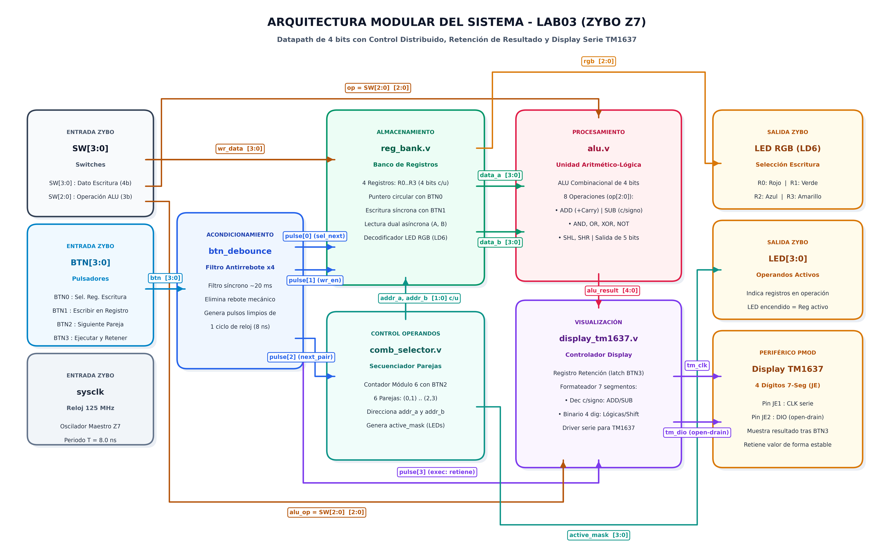
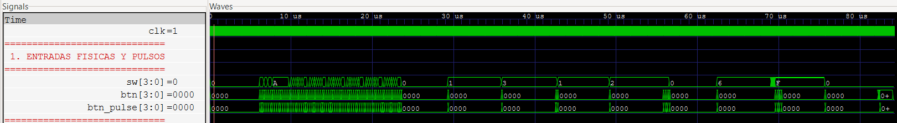
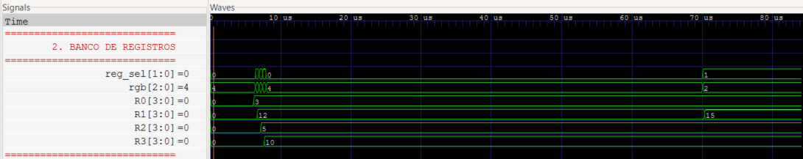
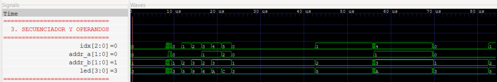
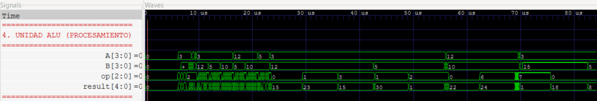
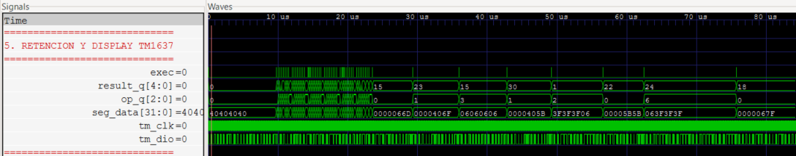

# Lab03 – ALU + Banco de Registros + Diseño Modular

## Integrantes  

- Julian David Gomez Gonzalez - 1007544331
- Cristian Norbey Hernández Gualteros - 1001091723
- Milton Nicolas Rincón Caicedo - 1021312724

**Semestre:** 2026-2  
**Plataforma:** Digilent Zybo Z7 (Zynq-7000)

---

## Índice

1. [Descripción del sistema](#1-descripción-del-sistema)
2. [Explicación de la arquitectura modular](#2-explicación-de-la-arquitectura-modular)
3. [Descripción de la estrategia de visualización utilizada](#3-descripción-de-la-estrategia-de-visualización-utilizada)
4. [Simulaciones y verificación en GTKWave](#4-simulaciones-y-verificación-en-gtkwave)
5. [Evidencia de funcionamiento en FPGA](#5-evidencia-de-funcionamiento-en-fpga)
6. [Análisis de resultados y conclusiones](#6-análisis-de-resultados-y-conclusiones)

---

## 1. Descripción del sistema

El sistema digital implementado en este laboratorio consiste en un **procesador elemental de 4 bits (*Datapath* con lógica de control distribuida)** desarrollado bajo una metodología de **diseño modular estricto** sobre la tarjeta de desarrollo **Digilent Zybo Z7 (Zynq-7000)**. El circuito integra en una jerarquía desacoplada e interactiva un banco de registros de propósito general, un secuenciador automático de combinaciones de operandos, una Unidad Aritmético-Lógica (ALU) combinacional de 4 bits y un subsistema de visualización en display de 7 segmentos serie basado en el controlador TM1637.

El flujo de operación del sistema se divide en cuatro etapas principales:

### 1.1. Almacenamiento y Gestión de Operandos (Banco de Registros)

Debido a la cantidad limitada de pines físicos de entrada en la tarjeta, el bus de cuatro interruptores `SW[3:0]` se multiplexa en el tiempo como el canal general de carga de datos:

- **Selección del registro destino (`BTN0`):** Cada pulsación del botón `BTN0` avanza de forma cíclica el puntero del registro donde se desea escribir (`R0` $\rightarrow$ `R1` $\rightarrow$ `R2` $\rightarrow$ `R3` $\rightarrow$ `R0`).
- **Indicador visual de selección (`LED RGB`):** Un decodificador interno refleja de inmediato cuál registro está seleccionado para escritura mediante código de color:
  - 🔴 **Rojo:** `R0`
  - 🟢 **Verde:** `R1`
  - 🔵 **Azul:** `R2`
  - 🟡 **Amarillo:** `R3`
- **Carga síncrona de datos (`BTN1`):** Al presionar `BTN1`, se genera un pulso síncrono de un ciclo de reloj (*Write Enable*) que memoriza el dato presente en `SW[3:0]` dentro del registro seleccionado. El circuito conserva el valor almacenado de forma indefinida, permitiendo modificar libremente los interruptores después de escribir sin alterar el contenido del registro.

### 1.2. Generación y Secuenciamiento de Parejas de Operandos

A diferencia de arquitecturas rígidas con operandos fijos, este diseño incorpora un selector automático que genera las combinaciones de pares de registros $(A, B)$ a operar:

- **Conmutación de combinaciones (`BTN2`):** Cada pulsación en `BTN2` incrementa un índice interno que recorre las **6 parejas de registros sin repetición**:
  $$\text{Combinaciones: } (R0, R1) \rightarrow (R0, R2) \rightarrow (R0, R3) \rightarrow (R1, R2) \rightarrow (R1, R3) \rightarrow (R2, R3) \rightarrow (R0, R1)$$
- **Monitoreo en LEDs estándar (`LED[3:0]`):** Los LEDs físicos se iluminan en correspondencia directa con los registros activos en la operación actual. Por ejemplo, al operar la combinación $(R0, R1)$, se encienden `LED0` y `LED1`, brindando certeza visual inmediata sobre los datos que alimentan a la ALU.

### 1.3. Procesamiento en la ALU (Unidad Aritmético-Lógica)

Los puertos de lectura combinacionales del banco de registros suministran en tiempo real los operandos $A$ y $B$ a la ALU. La operación a ejecutar se selecciona mediante los interruptores `SW[2:0]`, soportando 8 operaciones matemáticas y lógicas: Suma con acarreo, Resta con signo en complemento a 2, AND, OR, XOR, NOT y desplazamientos lógicos (izquierda y derecha).

### 1.4. Ejecución Síncrona y Retención de Memoria (*Latching*)

Para evitar fluctuaciones transitorias en la visualización durante la manipulación de controles, el circuito aísla el cálculo mediante un mecanismo de captura y persistencia:

- **Ejecución síncrona (`BTN3`):** La operación se ejecuta y se captura únicamente cuando el usuario presiona el pulsador `BTN3`. En ese ciclo exacto de reloj, un registro de retención congela tanto el resultado numérico de la ALU como el código de la operación activa.
- **Persistencia del display:** Mientras no se vuelva a presionar `BTN3`, el display **conserva y muestra de manera inalterada el resultado de la última operación realizada**. Si el usuario cambia los interruptores, conmuta la combinación de operandos o sobrescribe registros, el resultado en pantalla permanece congelado.
- **Interfaz de visualización (TM1637):** Un controlador digital dedicado traduce el valor retenido al protocolo serie de dos hilos (`CLK` y `DIO`), representando las operaciones matemáticas en **sistema decimal con signo** y las operaciones lógicas/desplazamientos en **sistema binario de 4 dígitos** para una interpretación intuitiva.

### 1.5. Mapeo de la Interfaz de Usuario en la Zybo Z7

La siguiente tabla resume la distribución de periféricos físicos en la placa de desarrollo:

| Periférico Físico | Identificador | Función en el Sistema |
| :--- | :---: | :--- |
| **Switches** | `SW[3:0]` | Bus de datos de entrada para escritura en registros ($0 \dots 15$). |
| | `SW[2:0]` | Selector de código de operación de la ALU ($0 \dots 7$). |
| **Botones** | `BTN0` | Conmuta cíclicamente el registro destino de escritura ($R0 \rightarrow R3$). |
| | `BTN1` | Habilita la carga síncrona del dato `SW[3:0]` en el registro seleccionado. |
| | `BTN2` | Conmuta cíclicamente la pareja de operandos $(A, B)$ entre las 6 combinaciones. |
| | `BTN3` | **Ejecuta la operación de la ALU** y actualiza el valor retenido en el display. |
| **LEDs Estándar** | `LED[3:0]` | Iluminación de los registros activos en la operación actual ($LED_n \rightarrow R_n$). |
| **LED RGB** | `LD6` | Color del registro seleccionado para escritura (🔴 $R0$, 🟢 $R1$, 🔵 $R2$, 🟡 $R3$). |
| **Display Externo** | `TM1637` (Pmod JE) | Muestra el resultado retenido de la última operación ejecutada. |

---

## 2. Explicación de la arquitectura modular

La arquitectura del sistema digital se fundamenta en un **procesador elemental de 4 bits (*Datapath* con control distribuido)** diseñado bajo una estricta jerarquía modular. Se establece una separación rigurosa entre:

1. **Lógica secuencial síncrona:** Bancos de almacenamiento, registros de estado, contadores de selección, filtros temporales y el registro de retención del resultado.
2. **Lógica combinacional pura:** Unidad aritmético-lógica (ALU), puertos de lectura paralela, decodificadores de visualización y formateador de segmentos.
3. **Módulo superior (`top.v`):** Estructura puramente de interconexión (*structural netlist*) que no contiene máquinas de estado complejas ni operaciones aritméticas internas, delegando cada función a su respectivo componente.

---

### 2.1. Diagrama de Bloques General de la Arquitectura

El siguiente diagrama representa el flujo completo de datos y control del sistema implementado, ilustrando la interacción entre las entradas físicas, los submódulos de procesamiento y almacenamiento, y las interfaces de visualización en la tarjeta Zybo Z7:

```mermaid
graph LR
    SW[Switches 3:0] --> |wr_data| RegBank(Banco de Registros)
    SW --> |op| ALU{ALU 4 bits}
    SW --> |alu_op| Display(Display TM1637)

    BTN0((BTN0)) -.-> |sel_next| RegBank
    BTN1((BTN1)) -.-> |write_enable| RegBank
    BTN2((BTN2)) -.-> |next| CombSel(Selector Combinaciones)
    BTN3((BTN3)) -.-> |exec| Display

    CombSel --> |addr_a| RegBank
    CombSel --> |addr_b| RegBank
    CombSel --> |active_mask| LEDs[LEDs 3:0 Registros Activos]

    RegBank --> |data_a| ALU
    RegBank --> |data_b| ALU
    RegBank --> |rgb| RGB[LED RGB]

    ALU --> |alu_result| Display

    Display --> |tm_clk| TM_CLK[Pin JE1 CLK]
    Display --> |tm_dio| TM_DIO[Pin JE2 DIO]

    style SW fill:#CC5500,stroke:#333
    style BTN0 fill:#013220,stroke:#333
    style BTN1 fill:#013220,stroke:#333
    style BTN2 fill:#013220,stroke:#333
    style BTN3 fill:#013220,stroke:#333
    style RegBank fill:#003153,stroke:#333
    style CombSel fill:#003153,stroke:#333
    style ALU fill:#950606,stroke:#333,stroke-width:2px
    style Display fill:#4B0082,stroke:#333
    style LEDs fill:#CC5500,stroke:#333
    style RGB fill:#CC5500,stroke:#333
    style TM_CLK fill:#CC5500,stroke:#333
    style TM_DIO fill:#CC5500,stroke:#333
```



<details>
<summary><b>Ver código fuente Mermaid del diagrama</b> (clic para desplegar)</summary>



</details>

---

### 2.2. Matriz de Interconexión y Buses del Datapath

La siguiente tabla resume todas las señales internas que conectan los módulos del sistema, su dirección, ancho de palabra y función operativa:

| Nombre de Señal | Módulo Origen | Módulo(s) Destino | Ancho | Tipo | Descripción Funcional |
| :--- | :--- | :--- | :---: | :---: | :--- |
| `sysclk` | Puerto Superior | Todos los módulos secuenciales | 1 bit | Reloj | Reloj del sistema principal (125 MHz, $T = 8\text{ ns}$). |
| `btn_pulse[0]` | `btn_debounce[0]` | `reg_bank` (`sel_next`) | 1 bit | Control | Pulso síncrono (1 ciclo) para conmutar registro de escritura ($R0 \rightarrow R3$). |
| `btn_pulse[1]` | `btn_debounce[1]` | `reg_bank` (`write_enable`) | 1 bit | Control | Pulso síncrono (1 ciclo) para habilitar escritura del dato `SW[3:0]`. |
| `btn_pulse[2]` | `btn_debounce[2]` | `comb_selector` (`next`) | 1 bit | Control | Pulso síncrono (1 ciclo) para avanzar a la siguiente combinación de operandos. |
| `btn_pulse[3]` | `btn_debounce[3]` | `display_tm1637` (`exec`) | 1 bit | Control | Pulso síncrono (1 ciclo) para ejecutar la ALU y retener el resultado en el display. |
| `sw[3:0]` | Puertos Físicos | `reg_bank` (`wr_data`) | 4 bits | Datos | Bus de datos de entrada a almacenar en el registro seleccionado. |
| `sw[2:0]` | Puertos Físicos | `alu` (`op`), `display_tm1637` (`alu_op`) | 3 bits | Control | Código de operación seleccionado para la ALU. |
| `addr_a[1:0]` | `comb_selector` | `reg_bank` (`addr_a`) | 2 bits | Dirección | Dirección del registro que actúa como operando $A$. |
| `addr_b[1:0]` | `comb_selector` | `reg_bank` (`addr_b`) | 2 bits | Dirección | Dirección del registro que actúa como operando $B$. |
| `active_mask[3:0]` | `comb_selector` | Puertos Físicos (`led[3:0]`) | 4 bits | Estado | Máscara de bits para encender los LEDs de los registros activos en la combinación. |
| `data_a[3:0]` | `reg_bank` | `alu` (`A`) | 4 bits | Datos | Contenido del operando $A$ leído del banco de registros. |
| `data_b[3:0]` | `reg_bank` | `alu` (`B`) | 4 bits | Datos | Contenido del operando $B$ leído del banco de registros. |
| `wr_addr[1:0]` | `reg_bank` | Monitor/Testbench | 2 bits | Estado | Registro actualmente apuntado para escritura ($0 \dots 3$). |
| `rgb[2:0]` | `reg_bank` | Puertos Físicos (`led6_r, g, b`) | 3 bits | Estado | Código de color del LED RGB indicando el registro apuntado para escritura. |
| `alu_result[4:0]` | `alu` | `display_tm1637` (`alu_result`) | 5 bits | Datos | Resultado combinacional instantáneo calculado por la ALU. |
| `result_latched[4:0]` | `display_tm1637` | Monitor/Testbench | 5 bits | Datos | Último resultado capturado y retenido tras pulsar `BTN3`. |
| `op_latched[2:0]` | `display_tm1637` | Monitor/Testbench | 3 bits | Control | Código de la última operación ejecutada y retenida. |
| `valid` | `display_tm1637` | Monitor/Testbench | 1 bit | Estado | Bandera que indica si ya se ha ejecutado al menos una operación. |
| `seg_data[31:0]` | `display_tm1637` (formateador) | `display_tm1637` (FSM TM1637) | 32 bits | Datos | Códigos de 7 segmentos de los 4 dígitos formateados listos para transmisión serie. |
| `tm_clk` | `display_tm1637` | Conector Pmod JE (Pin 1) | 1 bit | Salida | Señal de reloj serie de transmisión para el controlador TM1637. |
| `tm_dio` | `display_tm1637` | Conector Pmod JE (Pin 2) | 1 bit | Bidireccional | Línea serie de datos bidireccional (*open-drain*) con *pull-up*. |

---

### 2.3. Detalle de los Módulos Desarrollados

A continuación se describe la implementación técnica en lenguaje Verilog HDL de cada uno de los bloques del sistema:

#### 2.3.1. Módulo Superior de Integración (`top.v`) y Acondicionamiento (`btn_debounce`)

El módulo `top.v` actúa como la cúspide estructural (*structural wrapper*) del sistema. Su responsabilidad se limita a:

1. Declarar los puertos físicos de la tarjeta Zybo Z7 (reloj, switches, botones, LEDs, LED RGB y líneas del display TM1637).
2. Instanciar cuatro filtros antirrebote parametrizables (`btn_debounce`) para limpiar las pulsaciones mecánicas.
3. Interconectar mediante buses internos los cuatro bloques funcionales principales (`comb_selector`, `reg_bank`, `alu` y `display_tm1637`).

##### Tabla de Puertos de `top.v`

| Puerto | Dirección | Ancho | Tipo | Conexión Física / Función |
| :--- | :---: | :---: | :---: | :--- |
| `sysclk` | Entrada | 1 bit | Reloj | Oscilador principal de la tarjeta Zybo Z7 (125 MHz, Pin `K17`). |
| `sw` | Entrada | 4 bits | Datos / Control | `sw[3:0]`: Dato a escribir en registros. `sw[2:0]`: Operación de la ALU. |
| `btn` | Entrada | 4 bits | Control | `btn[0]`: Sel. registro, `btn[1]`: Escribir, `btn[2]`: Pareja, `btn[3]`: Ejecutar. |
| `led` | Salida | 4 bits | Estado | LEDs estándar `LD0`–`LD3` que reflejan los registros activos en la operación. |
| `led6_r` | Salida | 1 bit | Estado | Canal Rojo del LED RGB `LD6` (Pin `V16`). |
| `led6_g` | Salida | 1 bit | Estado | Canal Verde del LED RGB `LD6` (Pin `F17`). |
| `led6_b` | Salida | 1 bit | Estado | Canal Azul del LED RGB `LD6` (Pin `M17`). |
| `tm_clk` | Salida | 1 bit | Señal Serie | Reloj de sincronización serie hacia el display TM1637 (Pmod JE, Pin `V12`). |
| `tm_dio` | Bidireccional | 1 bit | Datos Serie | Línea serie bidireccional *open-drain* con *pull-up* hacia el TM1637 (Pmod JE, Pin `W16`). |

##### Módulo Auxiliar de Acondicionamiento (`btn_debounce`)

Ubicado al final de `top.v`, acondiciona cada pulsador físico mediante tres etapas consecutivas:

1. **Sincronizador biestable de 2 etapas (`sync0`, `sync1`):** Elimina el riesgo de metaestabilidad al ingresar señales asíncronas externas al dominio de reloj de 125 MHz.
2. **Contador de persistencia temporal (`cnt`):** Requiere que la señal se mantenga en el nuevo estado por `DEBOUNCE_CYCLES = 2_500_000` ciclos de reloj ($\approx 20\text{ ms}$). Si la señal oscila antes de alcanzar el umbral, el contador se reinicia automáticamente.
3. **Generador de pulso de un ciclo (*One-Pulse Generator*):** Al confirmarse un flanco de subida, la salida `pulse` se activa en alto por un único ciclo de reloj ($8\text{ ns}$), retornando inmediatamente a bajo.

```verilog
always @(posedge clk) begin
    sync0 <= btn_in;
    sync1 <= sync0;
    pulse <= 1'b0;

    if (sync1 == btn_level) begin
        cnt <= {CW{1'b0}};
    end else if (cnt == DEBOUNCE_CYCLES - 1) begin
        cnt       <= {CW{1'b0}};
        btn_level <= sync1;
        if (sync1)
            pulse <= 1'b1;  // Pulso síncrono limpio de 1 ciclo
    end else begin
        cnt <= cnt + 1'b1;
    end
end
```

---

#### 2.3.2. Módulo del Banco de Registros (`reg_bank.v`)

El módulo `reg_bank.v` implementa el almacenamiento de datos del procesador. Consta de una memoria de 4 registros de 4 bits (`regs[0]` a `regs[3]`), permitiendo retener valores arbitrarios introducidos mediante los switches físicos.

##### Características de Diseño

- **Puntero de selección circular (`reg_sel`):** Un registro de 2 bits avanza síncronamente con cada pulso de `sel_next` (`BTN0`), seleccionando cíclicamente el registro destino ($R0 \rightarrow R1 \rightarrow R2 \rightarrow R3 \rightarrow R0$).
- **Decodificador de color para LED RGB:** La función combinacional `rgb_lut` asocia cada dirección de escritura con un color característico:
  - $R0$ (`2'b00`) $\rightarrow$ `3'b100` (**Rojo**)
  - $R1$ (`2'b01`) $\rightarrow$ `3'b010` (**Verde**)
  - $R2$ (`2'b10`) $\rightarrow$ `3'b001` (**Azul**)
  - $R3$ (`2'b11`) $\rightarrow$ `3'b110` (**Amarillo**, Rojo + Verde)
- **Escritura síncrona con habilitador (*Clock Enable*):** Al pulsar `write_enable` (`BTN1`), el dato presente en `wr_data` (`SW[3:0]`) se captura en `regs[reg_sel]` en el siguiente flanco de subida de `clk`.
- **Doble puerto de lectura combinacional:** Posee dos buses de dirección independientes (`addr_a` y `addr_b`), permitiendo leer en paralelo los operandos $A$ y $B$ sin retardos de reloj.

##### Tabla de Puertos de `reg_bank.v`

| Puerto | Dirección | Ancho | Tipo | Descripción |
| :--- | :---: | :---: | :---: | :--- |
| `clk` | Entrada | 1 bit | Reloj | Reloj maestro del sistema (125 MHz). |
| `sel_next` | Entrada | 1 bit | Control | Pulso síncrono para avanzar el registro seleccionado para escritura (`BTN0`). |
| `write_enable` | Entrada | 1 bit | Control | Pulso síncrono de habilitación de escritura en el registro activo (`BTN1`). |
| `wr_data` | Entrada | 4 bits | Datos | Dato de entrada proveniente de los switches `SW[3:0]`. |
| `addr_a` | Entrada | 2 bits | Dirección | Dirección de lectura del operando $A$ ($0 \dots 3$). |
| `addr_b` | Entrada | 2 bits | Dirección | Dirección de lectura del operando $B$ ($0 \dots 3$). |
| `data_a` | Salida | 4 bits | Datos | Contenido leído del registro apuntado por `addr_a`. |
| `data_b` | Salida | 4 bits | Datos | Contenido leído del registro apuntado por `addr_b`. |
| `wr_addr` | Salida | 2 bits | Estado | Registro actualmente apuntado para escritura (para monitoreo/testbench). |
| `rgb` | Salida | 3 bits | Estado | Vector `{R, G, B}` para gobernar el LED RGB LD6. |

```verilog
// Escritura síncrona condicionada por write_enable
always @(posedge clk) begin
    if (write_enable)
        regs[reg_sel] <= wr_data;
end

// Puertos de lectura combinacional simultánea
assign data_a = regs[addr_a];
assign data_b = regs[addr_b];
```

---

#### 2.3.3. Módulo Selector de Combinaciones (`comb_selector.v`)

El módulo `comb_selector.v` automatiza la selección de las parejas de operandos $(A, B)$ a suministrar a la ALU, eliminando la necesidad de configurar manualmente las direcciones en los interruptores.

##### Características de Diseño

- **Contador de índice cíclico:** Un registro de 3 bits `idx` (rango $0 \dots 5$) se incrementa síncronamente con cada pulso de `next` (`BTN2`). Al alcanzar el valor 5, regresa automáticamente a 0.
- **Tabla de parejas sin repetición:** La función combinacional `comb_lut` asigna a cada índice una pareja única de registros:

| Índice (`idx`) | Operando $A$ (`addr_a`) | Operando $B$ (`addr_b`) | Máscara LEDs (`active_mask`) | LEDs Encendidos |
| :---: | :---: | :---: | :---: | :---: |
| `3'd0` | $R0$ (`2'd0`) | $R1$ (`2'd1`) | `4'b0011` | `LED0` y `LED1` |
| `3'd1` | $R0$ (`2'd0`) | $R2$ (`2'd2`) | `4'b0101` | `LED0` y `LED2` |
| `3'd2` | $R0$ (`2'd0`) | $R3$ (`2'd3`) | `4'b1001` | `LED0` y `LED3` |
| `3'd3` | $R1$ (`2'd1`) | $R2$ (`2'd2`) | `4'b0110` | `LED1` y `LED2` |
| `3'd4` | $R1$ (`2'd1`) | $R3$ (`2'd3`) | `4'b1010` | `LED1` y `LED3` |
| `3'd5` | $R2$ (`2'd2`) | $R3$ (`2'd3`) | `4'b1100` | `LED2` y `LED3` |

- **Generación de la máscara para LEDs:** Se calcula en tiempo real mediante desplazamientos lógicos decodificados a nivel de bits:
  $$\text{active\_mask} = (4'b0001 \ll \text{addr\_a}) \mid (4'b0001 \ll \text{addr\_b})$$
  Esto garantiza que los LEDs estándar de la tarjeta se iluminen de inmediato en sincronía con la pareja de operandos activa.

##### Tabla de Puertos de `comb_selector.v`

| Puerto | Dirección | Ancho | Tipo | Descripción |
| :--- | :---: | :---: | :---: | :--- |
| `clk` | Entrada | 1 bit | Reloj | Reloj maestro del sistema (125 MHz). |
| `next` | Entrada | 1 bit | Control | Pulso síncrono para avanzar a la siguiente combinación (`BTN2`). |
| `addr_a` | Salida | 2 bits | Dirección | Dirección del registro asignado como operando $A$. |
| `addr_b` | Salida | 2 bits | Dirección | Dirección del registro asignado como operando $B$. |
| `active_mask` | Salida | 4 bits | Estado | Máscara de 4 bits conectada directamente a los `LED[3:0]`. |

```verilog
always @(posedge clk) begin
    if (next)
        idx <= (idx == 3'd5) ? 3'd0 : idx + 3'd1;
end

assign {addr_a, addr_b} = comb_lut(idx);
assign active_mask      = (4'b0001 << addr_a) | (4'b0001 << addr_b);
```

---

#### 2.3.4. Módulo de la Unidad Aritmético-Lógica (`alu.v`)

El módulo `alu.v` es el núcleo de cálculo puramente combinacional del procesador. Carece de memoria y reloj, evaluando continuamente las entradas presentes en sus puertos.

##### Características de Diseño

- **Bus de salida extendido a 5 bits (`result[4:0]`):** A diferencia de una ALU estándar truncada a 4 bits, la salida de 5 bits evita la pérdida de información matemática esencial:
  - En la **Suma (`ADD`)**, el quinto bit ($result[4]$) actúa como el **acarreo de salida (*Carry Out*)**, extendiendo el rango dinámico a $[0, 30]$ ($15 + 15$).
  - En la **Resta (`SUB`)**, el cálculo `{1'b0, A} - {1'b0, B}` genera un valor en **complemento a 2 de 5 bits con signo**, cubriendo el rango $[-15, +15]$ sin incurrir en desbordamiento no detectado.
  - En el **Desplazamiento a la izquierda (`SHL`)**, la concatenación `{A, 1'b0}` almacena en $result[4]$ el bit más significativo que sale de $A[3]$.
- **Decodificación de operaciones:** Controlada por el selector de 3 bits `op[2:0]` (tomado de `SW[2:0]`), implementando las 8 funciones requeridas:

| Código `op[2:0]` | Operación | Función Ejecutada | Expresión Verilog | Rango / Formato de Salida |
| :---: | :---: | :--- | :--- | :--- |
| `000` | **ADD** | Suma aritmética | `{1'b0, A} + {1'b0, B}` | $[0, 30]$ (bit 4 = Carry Out) |
| `001` | **SUB** | Resta aritmética | `{1'b0, A} - {1'b0, B}` | $[-15, +15]$ (Complemento a 2, bit 4 = signo) |
| `010` | **AND** | Conjunción lógica | `{1'b0, A & B}` | 4 bits lógicos (bit 4 = 0) |
| `011` | **OR** | Disyunción lógica | `{1'b0, A \| B}` | 4 bits lógicos (bit 4 = 0) |
| `100` | **XOR** | Disyunción exclusiva | `{1'b0, A ^ B}` | 4 bits lógicos (bit 4 = 0) |
| `101` | **NOT** | Negación lógica de $A$ | `{1'b0, ~A}` | Inversión bit a bit (bit 4 = 0) |
| `110` | **SHL** | Desplazamiento a la izquierda | `{A, 1'b0}` | $A \ll 1$ (bit 4 = bit saliente $A[3]$) |
| `111` | **SHR** | Desplazamiento a la derecha | `{2'b00, A[3:1]}` | $A \gg 1$ (relleno con cero) |

##### Tabla de Puertos de `alu.v`

| Puerto | Dirección | Ancho | Tipo | Descripción |
| :--- | :---: | :---: | :---: | :--- |
| `A` | Entrada | 4 bits | Datos | Primer operando (suministrado por `data_a` del banco de registros). |
| `B` | Entrada | 4 bits | Datos | Segundo operando (suministrado por `data_b` del banco de registros). |
| `op` | Entrada | 3 bits | Control | Código de operación seleccionado mediante `SW[2:0]`. |
| `result` | Salida | 5 bits | Datos | Resultado del cálculo (aritmético con acarreo/signo o lógico extendido). |

```verilog
always @(*) begin
    case (op)
        OP_ADD:  result = {1'b0, A} + {1'b0, B}; // Rango: 0..30
        OP_SUB:  result = {1'b0, A} - {1'b0, B}; // Complemento a 2: -15..+15
        OP_AND:  result = {1'b0, A & B};
        OP_OR:   result = {1'b0, A | B};
        OP_XOR:  result = {1'b0, A ^ B};
        OP_NOT:  result = {1'b0, ~A};
        OP_SHL:  result = {A, 1'b0};            // Shift Left: bit 4 = A[3]
        default: result = {2'b00, A[3:1]};       // OP_SHR: Shift Right
    endcase
end
```

---

#### 2.3.5. Subsistema de Visualización y Retención (`display_tm1637.v`)

El módulo `display_tm1637.v` integra en una única jerarquía el mecanismo de persistencia del resultado, el formateo numérico y el controlador de comunicación serie para el periférico físico TM1637.

##### Tabla de Puertos de `display_tm1637.v`

| Puerto | Dirección | Ancho | Tipo | Descripción |
| :--- | :---: | :---: | :---: | :--- |
| `clk` | Entrada | 1 bit | Reloj | Reloj maestro del sistema (125 MHz). |
| `exec` | Entrada | 1 bit | Control | Pulso síncrono para ejecutar y actualizar la visualización (`BTN3`). |
| `alu_op` | Entrada | 3 bits | Control | Código de operación seleccionado en `SW[2:0]`. |
| `alu_result` | Entrada | 5 bits | Datos | Resultado combinacional instantáneo proveniente de la ALU. |
| `tm_clk` | Salida | 1 bit | Reloj Serie | Línea de reloj del bus serie TM1637. |
| `tm_dio` | Bidireccional | 1 bit | Datos Serie | Línea de datos bidireccional *open-drain* del bus serie TM1637. |
| `result_latched` | Salida | 5 bits | Datos | Último resultado retenido (monitoreo en testbench/GTKWave). |
| `op_latched` | Salida | 3 bits | Control | Última operación retenida (monitoreo en testbench/GTKWave). |
| `valid` | Salida | 1 bit | Estado | Bandera que certifica la ejecución de al menos una operación. |
| `seg_data` | Salida | 32 bits | Datos | Vector con la codificación de 7 segmentos de los 4 dígitos. |

*(La descripción exhaustiva de la estrategia de visualización, formateo y driver se detalla en la [Sección 3](#3-descripción-de-la-estrategia-de-visualización-utilizada)).*

---

## 3. Descripción de la estrategia de visualización utilizada

La visualización de los datos es un componente crítico del sistema digital, ya que permite interpretar de forma inequívoca el resultado de las operaciones aritméticas y lógicas, así como conocer el estado interno de la máquina (registro seleccionado y operandos activos).

### 3.1. Criterio de Representación Numérica en el Display TM1637

Para optimizar la claridad interpretativa de cada operación, el sistema implementa una **estrategia de visualización adaptativa según el tipo de operación**:

| Operación / Estado | Código `op[2:0]` | Formato en Display TM1637 | Rango / Ejemplo |
| :--- | :---: | :--- | :--- |
| **Estado Inicial** | — | Cuatro guiones centrales (`----`) | `----` |
| **Suma (ADD)** | `000` | Decimal con signo (alineado a la derecha en 4 dígitos) | `0` a `30` (ej: `[ ][ ][ ][7]` $\rightarrow$ `"   7"`, `[ ][ ][2][4]` $\rightarrow$ `"  24"`) |
| **Resta (SUB)** | `001` | Decimal con signo (alineado a la derecha en 4 dígitos) | `-15` a `+15` (ej: `[ ][ ][-][7]` $\rightarrow$ `"  -7"`, `[ ][-][1][5]` $\rightarrow$ `" -15"`) |
| **Lógicas (AND, OR, XOR, NOT)** | `010` – `101` | Binario de 4 dígitos (bits 3..0 individuales) | `"0000"` a `"1111"` (ej: `"1010"`) |
| **Desplazamientos (SHL, SHR)** | `110`, `111` | Binario de 4 dígitos (bits 3..0 individuales) | `"0000"` a `"1111"` (ej: `"0100"`) |

#### 1. Estado Inicial sin Ejecución Previa (`!reg_valid`)

Al encender o reiniciar el sistema, la bandera interna `reg_valid` inicia en `0`. Para indicar al usuario que aún no se ha ejecutado ninguna operación mediante `BTN3`, el formateador genera el código de segmento del guion medio (`8'h40`) en los cuatro dígitos:
$$\text{Display: } \texttt{----}$$

#### 2. Operaciones Aritméticas (Suma `000` y Resta `001`): Decimal con Signo

Las operaciones aritméticas representan magnitudes numéricas escalares, por lo que su lectura en formato decimal resulta inmediata e intuitiva para el usuario. El display físico cuenta con 4 posiciones ($d_0, d_1, d_2, d_3$, de izquierda a derecha), las cuales se mapean rigurosamente:

- **Suma con Acarreo:** Como los operandos $A, B \in [0, 15]$, la suma puede alcanzar hasta $30$. El resultado se descompone en decenas y unidades BCD mediante:
  $$\text{tens} = \text{result} / 10, \quad \text{units} = \text{result} \% 10$$
  El dígito más a la izquierda ($d_0$) se mantiene siempre apagado (`BLANK`). Si $\text{tens} = 0$, también se apagan $d_1$ y $d_2$, mostrando el valor únicamente en $d_3$ (por ejemplo, el valor $7$ se visualiza como $\texttt{"   7"}$). Si $\text{tens} > 0$, las decenas se ubican en $d_2$ y las unidades en $d_3$ (por ejemplo, el valor $24$ se visualiza como $\texttt{"  24"}$).
- **Resta con Signo en Complemento a 2:** Si el operando $A < B$, el bit más significativo $result[4]$ se activa en alto, indicando un número negativo en complemento a 2. El módulo calcula su valor absoluto o magnitud positiva:
  $$\text{mag} = \sim \text{result} + 1$$
  Calcula sus decenas y unidades, e inserta dinámicamente el carácter de signo menos ($\texttt{-}$) a la izquierda del dígito más significativo:
  - Para magnitudes de un dígito (ej: $-7$), el signo se ubica en $d_2$ y la unidad en $d_3$ ($\texttt{"  -7"}$).
  - Para magnitudes de dos dígitos (ej: $-15$), el signo se ubica en $d_1$, las decenas en $d_2$ y las unidades en $d_3$ ($\texttt{" -15"}$).

#### 3. Operaciones Lógicas y Desplazamientos: Binario de 4 Dígitos

Las operaciones lógicas (AND, OR, XOR, NOT) y los desplazamientos a nivel de bits (SHL, SHR) operan de forma independiente sobre cada posición binaria. Mostrarlas en base decimal carece de significado conceptual. Por ello, se representan como una **palabra binaria de 4 dígitos** aprovechando exactamente los cuatro dígitos del display TM1637:
$$\text{Dígito 0} = result[3], \quad \text{Dígito 1} = result[2], \quad \text{Dígito 2} = result[1], \quad \text{Dígito 3} = result[0]$$
Por ejemplo, si la operación AND entre `1100` y `1010` produce `1000`, el display muestra directamente $\texttt{1000}$.

---

### 3.2. Mecanismo de Retención y Congelamiento (*Latching*) con `BTN3`

Uno de los requerimientos más estrictos del laboratorio consiste en que **el resultado mostrado en el display debe permanecer congelado hasta que se presione explícitamente `BTN3`**:

1. **Aislamiento en Biestables:** La salida instantánea de la ALU y el código de operación viajan directamente a un registro de retención síncrono. Únicamente cuando el pulso síncrono `exec` (derivado de `BTN3`) se activa por 1 ciclo de reloj, se cargan los datos:

   ```verilog
   always @(posedge clk) begin
       if (exec) begin
           reg_result <= alu_result;
           reg_op     <= alu_op;
           reg_valid  <= 1'b1;
       end
   end
   ```

2. **Inmunidad frente a cambios en controles:** Mientras `BTN3` no sea presionado:
   - Si el usuario conmuta los interruptores `SW[3:0]` o la operación `SW[2:0]`, el display **no cambia**.
   - Si se avanza la combinación de operandos con `BTN2`, el display **no cambia**.
   - Si se seleccionan registros con `BTN0` o se escriben nuevos datos con `BTN1`, el display **no cambia**.
   El usuario visualiza de manera permanente y estable el resultado de la última operación ejecutada.

---

### 3.3. Driver de Comunicación Serie para el Periférico TM1637

El controlador físico TM1637 se comunica mediante un protocolo propietario síncrono de dos hilos similar a I2C:

- **Base de Tiempo Serie:** El parámetro `CLK_DIV = 1250` divide la frecuencia de 125 MHz a una tasa segura de aproximadamente $100\text{ kHz}$.
- **Línea de Datos Bidireccional (`tm_dio`):** Se implementa en configuración de colector/drenador abierto (*open-drain*):

  ```verilog
  assign tm_dio = dio_low ? 1'b0 : 1'bz;
  ```

  La tarjeta Zybo Z7 activa una resistencia interna de elevación (*pull-up*) mediante el archivo de restricciones XDC (`PULLUP true`).
- **Secuencia de Transmisión (FSM):** Para actualizar la pantalla, la máquina de estados ejecuta tres tramas serie completas:
  1. **Comando de Modo de Datos (`0x40`):** Configura el chip en modo de dirección automática.
  2. **Comando de Dirección Base (`0xC0`) + 4 Bytes de Datos:** Transmite la dirección del primer display y consecutivamente los códigos de los dígitos 0 a 3 en formato LSB-first, liberando la línea `tm_dio` en cada noveno ciclo para recibir el pulso de confirmación (ACK) del periférico.
  3. **Comando de Control de Pantalla (`0x8F`):** Enciende el display y fija el ciclo de trabajo de brillo al máximo nivel.

---

### 3.4. Indicadores Visuales Complementarios (LEDs Estándar y LED RGB)

Además del display de 7 segmentos, el sistema cuenta con dos subsistemas de monitoreo visual en tiempo real:

1. **LEDs Estándar de la Placa (`LED[3:0]`):**
   - Cada LED corresponde unívocamente a un registro: $LED0 \rightarrow R0$, $LED1 \rightarrow R1$, $LED2 \rightarrow R2$, $LED3 \rightarrow R3$.
   - Al conmutar combinaciones con `BTN2`, se iluminan de forma fija los dos LEDs correspondientes a los registros que actúan como operandos activos $A$ y $B$.
2. **LED RGB (`LD6`):**
   - Indica el registro que se encuentra actualmente seleccionado para escritura mediante `BTN0`.
   - Código de colores:
     - 🔴 **Rojo (`3'b100`):** Registro $R0$ seleccionado.
     - 🟢 **Verde (`3'b010`):** Registro $R1$ seleccionado.
     - 🔵 **Azul (`3'b001`):** Registro $R2$ seleccionado.
     - 🟡 **Amarillo (`3'b110`):** Registro $R3$ seleccionado.

---

## 4. Simulaciones y verificación en GTKWave

La verificación funcional del sistema se llevó a cabo de manera rigurosa mediante un banco de pruebas exhaustivo ([sim/tb_top.v](file:///c:/Users/julia/Desktop/U/SEPTIMO/digital2/Lab03/sim/tb_top.v)) y la ejecución de simulaciones con Icarus Verilog y GTKWave.

### 4.1. Metodología de Simulación

Para acelerar la simulación sin alterar la lógica de control, se parametrizaron las constantes temporales:

- `DEBOUNCE_CYCLES = 4`: Permite que el filtro antirrebote valide pulsos en pocos ciclos de reloj.
- `TM_CLK_DIV = 2`: Acelera la generación del reloj serie del TM1637 para verificar las tramas completas en un tiempo de simulación reducido.

El testbench valida automáticamente mediante modelos de referencia internos (*golden models*):

1. La escritura secuencial de valores de prueba en los registros $R0=3$, $R1=12$, $R2=5$, $R3=10$ (y posterior reescritura de $R1=15$).
2. El correcto encendido del LED RGB con cada registro seleccionado.
3. El recorrido cíclico por las 6 parejas de operandos $(R0, R1) \dots (R2, R3)$ y la activación de `LED[3:0]`.
4. El cómputo de la ALU para las 8 operaciones en todas las combinaciones (48 operaciones verificadas).
5. El congelamiento estricto del valor en el display mientras no se genera el pulso `BTN3`.
6. La correcta codificación en el formateador y la emisión física de tramas en las líneas `tm_clk` y `tm_dio`.

### 4.2. Capturas de Formas de Onda y Análisis de Transiciones (GTKWave)

Las siguientes capturas fueron extraídas directamente de la simulación del sistema completo en GTKWave ([tb_top.vcd](file:///c:/Users/julia/Desktop/U/SEPTIMO/digital2/Lab03/sim/tb_top.vcd)), demostrando el comportamiento síncrono y combinacional de cada bloque en el tiempo:

---

#### 4.2.1. Acondicionamiento de Entradas Físicas y Generación de Pulsos

El primer grupo de ondas verifica la captura de estímulos físicos (`sw` y `btn`) y el filtrado digital temporal ejecutado por los módulos `btn_debounce`:



- **Señales Observadas:**
  - `clk`: Reloj maestro de 125 MHz ($T = 8\text{ ns}$).
  - `sw[3:0]`: Bus de switches que suministra tanto los datos numéricos de carga como el código de operación de la ALU.
  - `btn[3:0]`: Señales físicas provenientes de los pulsadores.
  - `btn_pulse[3:0]`: Pulsos limpios generados por el módulo antirrebote.
- **Análisis de la Transición:**  
  A pesar de que las señales `btn[3:0]` provienen de pulsadores asíncronos y permanecen activas durante múltiples periodos de reloj, el circuito genera un pulso síncrono `btn_pulse[k]` de exactamente **un ciclo de reloj de ancho ($8\text{ ns}$)** en el primer flanco de subida confirmado tras el periodo de persistencia. Esto garantiza que las transiciones de estado en el banco de registros, el secuenciador y el latch del display ocurran exactamente una vez por pulsación, previniendo rebotes o activaciones múltiples indeseadas.

---

#### 4.2.2. Gestión y Escritura en el Banco de Registros

En esta etapa se comprueba la conmutación del puntero de selección, la respuesta del decodificador RGB y la carga de datos en los 4 registros internos:



- **Señales Observadas:**
  - `reg_sel[1:0]`: Puntero circular que indica el registro destino de escritura ($0 \dots 3$).
  - `rgb[2:0]`: Vector de color hacia el LED RGB LD6 (`3'b100`: Rojo, `3'b010`: Verde, `3'b001`: Azul, `3'b110`: Amarillo).
  - `R0`, `R1`, `R2`, `R3`: Contenido numérico de cada registro de 4 bits.
- **Análisis de la Transición:**  
  1. **Inicialización:** Todos los registros inician en $0$. El puntero arranca en `reg_sel = 0` ($R0$), activando `rgb = 4` (`3'b100`, 🔴 Rojo).
  2. **Carga Secuencial:** 
     - Con `sw = 3`, se aplica el pulso `BTN1`, cargando de inmediato $R0 = 3$.
     - Al pulsar `BTN0`, `reg_sel` avanza a $1$ (`rgb = 2`, 🟢 Verde), y con `BTN1` se escribe $R1 = 12$.
     - Se avanza a `reg_sel = 2` (`rgb = 1`, 🔵 Azul), cargando $R2 = 5$.
     - Se avanza a `reg_sel = 3` (`rgb = 6`, 🟡 Amarillo), cargando $R3 = 10$.
     - Una pulsación adicional en `BTN0` retorna cíclicamente el puntero a $R0$ (`rgb = 4`, 🔴 Rojo).
  3. **Reescritura Selectiva (en $t \approx 71\ \mu\text{s}$):** Más adelante en la prueba se conmuta intencionalmente el puntero hacia $R1$ (`reg_sel = 1`) y se sobrescribe con el dato $15$. La forma de onda evidencia que únicamente $R1$ se actualiza a $15$, mientras $R0=3$, $R2=5$ y $R3=10$ se mantienen inalterados, validando el aislamiento entre registros.

---

#### 4.2.3. Secuenciador de Combinaciones y Monitoreo en LEDs

Esta sección ilustra la generación automática de las 6 parejas de operandos $(A, B)$ a partir de los pulsos del botón `BTN2`:



- **Señales Observadas:**
  - `idx[2:0]`: Índice secuencial del contador módulo 6 ($0 \dots 5$).
  - `addr_a[1:0]` y `addr_b[1:0]`: Direcciones leídas en paralelo por el banco de registros.
  - `led[3:0]`: Máscara lógica reflejada directamente en los LEDs estándar de la Zybo Z7.
- **Análisis de la Transición:**  
  Con cada pulso en `BTN2`, `idx` se incrementa progresivamente, decodificando las combinaciones sin repetición:
  - $\text{idx} = 0 \rightarrow \text{addr\_a} = 0\ (R0), \text{addr\_b} = 1\ (R1) \rightarrow \text{led} = 4'\text{b}0011\ (0\text{x}3) \rightarrow \text{LED0 y LED1 encendidos}$.
  - $\text{idx} = 1 \rightarrow \text{addr\_a} = 0\ (R0), \text{addr\_b} = 2\ (R2) \rightarrow \text{led} = 4'\text{b}0101\ (0\text{x}5) \rightarrow \text{LED0 y LED2 encendidos}$.
  - $\text{idx} = 2 \rightarrow \text{addr\_a} = 0\ (R0), \text{addr\_b} = 3\ (R3) \rightarrow \text{led} = 4'\text{b}1001\ (0\text{x}9) \rightarrow \text{LED0 y LED3 encendidos}$.
  - $\text{idx} = 3 \rightarrow \text{addr\_a} = 1\ (R1), \text{addr\_b} = 2\ (R2) \rightarrow \text{led} = 4'\text{b}0110\ (0\text{x}6) \rightarrow \text{LED1 y LED2 encendidos}$.
  - $\text{idx} = 4 \rightarrow \text{addr\_a} = 1\ (R1), \text{addr\_b} = 3\ (R3) \rightarrow \text{led} = 4'\text{b}1010\ (0\text{xA}) \rightarrow \text{LED1 y LED3 encendidos}$.
  - $\text{idx} = 5 \rightarrow \text{addr\_a} = 2\ (R2), \text{addr\_b} = 3\ (R3) \rightarrow \text{led} = 4'\text{b}1100\ (0\text{xC}) \rightarrow \text{LED2 y LED3 encendidos}$.
  - Tras alcanzar el índice 5, el siguiente pulso reinicia de forma limpia el contador a $\text{idx} = 0$, demostrando el comportamiento cíclico continuo del secuenciador.

---

#### 4.2.4. Cómputo Combinacional en la Unidad ALU de 4 Bits

La simulación valida las 8 operaciones aritméticas y lógicas sobre los operandos entregados en tiempo real por el banco de registros:



- **Señales Observadas:**
  - `A[3:0]` y `B[3:0]`: Datos de los operandos activos seleccionados.
  - `op[2:0]`: Código de operación introducido mediante `sw[2:0]`.
  - `result[4:0]`: Resultado de 5 bits generado instantáneamente por la lógica combinacional.
- **Análisis de la Transición:**  
  La ALU evalúa en tiempo real las operaciones sin retardos de reloj:
  - **Suma (`op = 0`):** Con $A=3$ y $B=12$, $\text{result} = 3 + 12 = 15$ (`5'd15`). Con $A=12$ y $B=10$, $\text{result} = 12 + 10 = 22$ (`5'd22`). Con $A=3$ y $B=15$, $\text{result} = 3 + 15 = 18$ (`5'd18`).
  - **Resta con Signo (`op = 1`):** Con $A=3$ y $B=12$, la operación $3 - 12 = -9$ genera en complemento a 2 de 5 bits la palabra binaria $5'\text{b}10111$ (representada como `23` decimal sin signo en el visor de ondas). Con $A=3$ y $B=5$, $3 - 5 = -2 = 5'\text{b}11110$ (representado como `30` sin signo).
  - **Operaciones Lógicas (`op = 2, 3`):** Con $A=3\ (0011_2)$ y $B=12\ (1100_2)$, la disyunción OR (`op=3`) produce $1111_2$ (`15`). Con $A=3\ (0011_2)$ y $B=5\ (0101_2)$, la conjunción AND (`op=2`) produce $0001_2$ (`1`).
  - **Desplazamiento a la Izquierda (`op = 6`):** Con $A=12\ (1100_2)$, $A \ll 1$ genera $11000_2$ (`24`), demostrando que el bit más significativo $A[3]=1$ se desplaza correctamente hacia la posición de acarreo `result[4]`.

---

#### 4.2.5. Retención de Memoria (*Latching*), Formateo y Driver Serie TM1637

Esta captura confirma el mecanismo central de persistencia del resultado frente a perturbaciones en los controles, así como la traducción a los códigos de 7 segmentos:



- **Señales Observadas:**
  - `exec`: Pulso de ejecución síncrono derivado de `BTN3`.
  - `result_q[4:0]`: Registro que retiene el resultado de la ALU.
  - `op_q[2:0]`: Registro que retiene el código de operación.
  - `seg_data[31:0]`: Vector de 32 bits con la codificación de 7 segmentos de los 4 dígitos (`{d0, d1, d2, d3}`).
  - `tm_clk` y `tm_dio`: Reloj y datos serie transmitidos al módulo físico TM1637.
- **Análisis de la Transición:**  
  1. **Estado Inicial:** Antes de la primera ejecución con `BTN3`, `seg_data = 32'h40404040`, lo que representa cuatro caracteres de guion medio ($\texttt{"----"}$).
  2. **Traducción Numérica Adaptativa tras `BTN3` (`exec`):**
     - Suma $3 + 12 = 15$: `seg_data = 32'h0000066D` $\rightarrow$ Dígitos `[BLANK][BLANK]['1']['5']` ($\texttt{"  15"}$).
     - Resta $3 - 12 = -9$: `seg_data = 32'h0000406F` $\rightarrow$ Dígitos `[BLANK][BLANK]['-']['9']` ($\texttt{"  -9"}$).
     - Lógica OR $1111_2$: `seg_data = 32'h06060606` $\rightarrow$ Dígitos binarios $\texttt{"1111"}$.
     - Resta $3 - 5 = -2$: `seg_data = 32'h0000405B` $\rightarrow$ Dígitos `[BLANK][BLANK]['-']['2']` ($\texttt{"  -2"}$).
     - Lógica AND $0001_2$: `seg_data = 32'h3F3F3F06` $\rightarrow$ Dígitos binarios $\texttt{"0001"}$.
     - Suma $12 + 10 = 22$: `seg_data = 32'h00005B5B` $\rightarrow$ Dígitos `[BLANK][BLANK]['2']['2']` ($\texttt{"  22"}$).
     - Shift Left $12 \ll 1$: `seg_data = 32'h063F3F3F` $\rightarrow$ Dígitos binarios $\texttt{"1000"}$.
  3. **Comprobación de Persistencia Inalterada (Intervalo $t = 63\ \mu\text{s}$ a $76\ \mu\text{s}$):** Durante esta ventana, el testbench manipula activamente todos los interruptores `sw`, conmuta parejas de operandos con `BTN2` y reescribe registros con `BTN1`. En la gráfica se aprecia claramente que `result_q = 24`, `op_q = 6` y `seg_data = 32'h063F3F3F` **permanecen absolutamente estables y congelados**, demostrando la total inmunidad del visor ante cambios posteriores en las entradas.
  4. **Nueva Actualización:** Solo cuando se pulsa nuevamente `BTN3` en $t \approx 76\ \mu\text{s}$, el registro se desbloquea para capturar el nuevo resultado ($18$), pasando `seg_data` a `32'h0000067F` ($\texttt{"  18"}$).
  5. **Transmisión Serie Física:** Las oscilaciones continuas en `tm_clk` y `tm_dio` confirman que el driver FSM serializa e inyecta sin interrupción las tramas I2C-like en colector abierto para refrescar el display exterior.

---

## 5. Evidencia de funcionamiento en FPGA

Una vez validada la simulación, se procede a la implementación en la placa Digilent Zybo Z7 asignando los pines correspondientes.

### 5.1. Asignación de Pines (`constrs/zybo_z7.xdc`)

| Puerto | Pin Zybo Z7 | Estándar I/O | Descripción |
| :--- | :---: | :---: | :--- |
| `sysclk` | `K17` | LVCMOS33 | Reloj del sistema (125 MHz). |
| `sw[0]` | `G15` | LVCMOS33 | Switch 0 (Dato bit 0 / OpCode bit 0). |
| `sw[1]` | `P15` | LVCMOS33 | Switch 1 (Dato bit 1 / OpCode bit 1). |
| `sw[2]` | `W13` | LVCMOS33 | Switch 2 (Dato bit 2 / OpCode bit 2). |
| `sw[3]` | `T16` | LVCMOS33 | Switch 3 (Dato bit 3). |
| `btn[0]` | `K18` | LVCMOS33 | Botón 0: Seleccionar registro de escritura. |
| `btn[1]` | `P16` | LVCMOS33 | Botón 1: Escribir dato en registro. |
| `btn[2]` | `K19` | LVCMOS33 | Botón 2: Conmutar combinación de operandos. |
| `btn[3]` | `Y16` | LVCMOS33 | Botón 3: Ejecutar operación y actualizar display. |
| `led[0]` | `M14` | LVCMOS33 | LED 0: Indica $R0$ activo. |
| `led[1]` | `M15` | LVCMOS33 | LED 1: Indica $R1$ activo. |
| `led[2]` | `G14` | LVCMOS33 | LED 2: Indica $R2$ activo. |
| `led[3]` | `D18` | LVCMOS33 | LED 3: Indica $R3$ activo. |
| `led6_r` | `V16` | LVCMOS33 | LED RGB LD6 (Canal Rojo). |
| `led6_g` | `F17` | LVCMOS33 | LED RGB LD6 (Canal Verde). |
| `led6_b` | `M17` | LVCMOS33 | LED RGB LD6 (Canal Azul). |
| `tm_clk` | `V12` | LVCMOS33 | Conector Pmod JE Pin 1 (Reloj TM1637). |
| `tm_dio` | `W16` | LVCMOS33 | Conector Pmod JE Pin 2 (Datos TM1637, PULLUP). |

### 5.2. Pruebas y Evidencia en Placa

> **[PENDIENTE DE IMPLEMENTACIÓN EN FPGA]**  
> *Adjuntar aquí fotos del montaje físico y/o enlace al video demostrativo del funcionamiento en la FPGA Zybo Z7.*

---

## 6. Análisis de resultados y conclusiones

> **[PENDIENTE]**  
> *Redactar el análisis técnico de los resultados obtenidos y las conclusiones finales una vez completadas las etapas de simulación e implementación física.*
